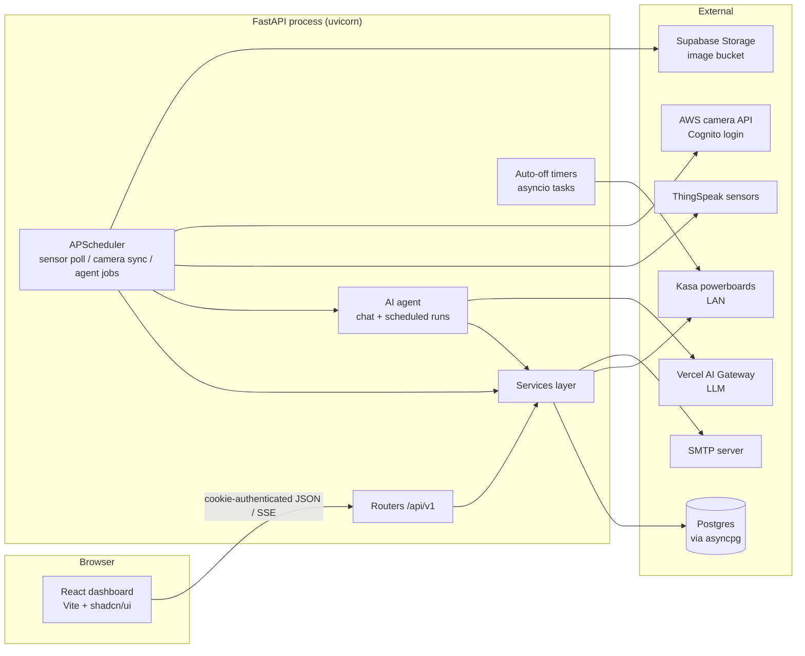

# Leafy — System Maintenance Document (SMD)

Last updated: 2026-10-14

This document describes the Leafy system for the people who operate and maintain it: what the system does, how it is put together, what it depends on, how to run it, and what to check when something goes wrong. For API contracts see [docs/api-v1.md](api-v1.md); for contributor conventions see [AGENTS.md](../AGENTS.md) and [frontend/AGENTS.md](../frontend/AGENTS.md).

---

## 1. System overview

Leafy is a full-stack monitoring and control application for a hydroponic farm. It:

- **Collects sensor data** (water pH, EC, water/ambient temperature, humidity, reservoir level) by polling a ThingSpeak feed every 30 seconds and charting the history on the dashboard.
- **Syncs camera images** hourly from a tutor-provided AWS API into a Supabase Storage bucket and shows the latest image per camera.
- **Runs an AI agent** (chat and scheduled runs) that can read sensors and cameras, raise/update/resolve dashboard alerts, send admin emails, and **propose** switching devices on — a human must approve every device run.
- **Controls TP-Link Kasa powerboards** over the local network: approved proposals switch an outlet on and an in-process timer switches it off when the run ends; users can also switch devices on/off manually.
- **Manages alerts and email notifications** with an explicit lifecycle (dismiss ≠ resolve) and a full audit log of every email send.

It is an **internal application**: there is no public sign-up, no roles — every signed-in user has full access. Accounts are created by an administrator via the CLI.

## 2. Architecture

One repository, one deployed process (plus the Vite dev server during development). The FastAPI backend serves the API under `/api/v1` and, in production, the built React frontend.



Key design rules:

- **Routers stay thin.** All business logic lives in `backend/services/`, where functions take an `AsyncSession` plus plain arguments. The agent's tools call the same service functions directly, without HTTP.
- **Device control is proposal-based for the agent.** The agent can only call `propose_device_run`; a person approves or rejects on the Overview or Logs page. Humans can switch devices directly on the Devices page.
- **The frontend never handles tokens.** Sessions are HttpOnly JWT cookies; the client just sends `credentials: 'include'`.

## 3. Technology stack

| Layer | Technology |
| --- | --- |
| Language / runtime | Python ≥ 3.14, managed with `uv` |
| Web framework | FastAPI + Uvicorn (ASGI) |
| ORM / DB driver | SQLModel (SQLAlchemy async) + asyncpg → Postgres (Supabase-hosted; only its Postgres is used, not Auth/BaaS) |
| Validation | Pydantic v2 (camelCase aliases at the API boundary) |
| Scheduling | APScheduler (`AsyncIOScheduler`, in-process) |
| AI | Python `ai` package through the Vercel AI Gateway; responses streamed as AI SDK UI SSE |
| Device control | `python-kasa` (local network discovery per command) |
| Auth | Self-hosted JWT (PyJWT, HS256) in HttpOnly cookie; Argon2 password hashing via `pwdlib` |
| Email | `aiosmtplib` |
| Frontend | React 19, TypeScript, Vite, Tailwind CSS v4, shadcn/ui, `react-router-dom` v7, `recharts` v3 |
| Tests / lint | pytest (+ pytest-asyncio, httpx), ruff (tabs, line length 120); ESLint + `tsc` on the frontend |

## 4. Repository layout

```text
.
├── main.py                    # FastAPI entry point: lifespan, routers, SPA static serving
├── system_prompt.md           # The agent's system prompt (behavioral rules live here)
├── schema.sql                 # Database schema — documentation only, NOT meant to be executed
├── pyproject.toml             # Dependencies + ruff config
├── .env.example               # Template for the user-managed .env
├── backend/
│   ├── cli.py                 # Typer CLI: create-user, list-users, delete-user, sync-cameras
│   ├── settings.py            # Pydantic Settings (reads .env), get_settings() is lru_cached
│   ├── db_models/             # SQLModel table models
│   ├── dependencies/          # FastAPI deps: auth (cookie → user), database_session (cached engine)
│   ├── router/                # Thin API routers, registered in router/api.py under /api/v1
│   ├── schemas/               # Pydantic request/response models (camelCase aliases)
│   ├── schedule/              # APScheduler setup + jobs: poll_sensors, sync_cameras, agent_job
│   └── services/              # Business logic; agent/ holds build_agent + agent_tools/
├── frontend/                  # React dashboard (see frontend/AGENTS.md)
│   └── src/
│       ├── App.tsx            # Auth gate + routes
│       ├── api/               # Fetch wrapper + typed endpoint clients
│       ├── components/        # Shell, navigation.ts (sidebar source of truth), ui/ (shadcn)
│       └── features/          # One folder per page: overview, alerts, agents, schedules, devices, logpage, proposals, auth
├── docs/api-v1.md             # API reference (source of truth for HTTP contracts)
├── sample-data/               # Static camera image for the mock camera route
└── tests/                     # pytest suite (app smoke, alerts, devices, proposals, outlets)
```

Pages map 1:1 to sidebar entries: Overview, Alerts, Agents, Schedules, Devices, Logs. Adding a page = feature folder + route in `src/App.tsx` + entry in `src/components/navigation.ts`.

## 5. Runtime components

### 5.1 FastAPI application (`main.py`)

- Creates the app with a lifespan that: configures logging, starts the scheduler, resumes auto-off timers for device runs that were in progress (`proposals.resume_auto_off()`), and cancels timers on shutdown.
- Registers `backend/router/api.py` (prefix `/api/v1`).
- When `ENVIRONMENT=production`, mounts `SinglePageApp` (a `StaticFiles` subclass) at `/` serving `frontend/dist/` with an `index.html` fallback so client-side routes survive reloads. Note: Starlette *raises* `HTTPException(404)` from `StaticFiles`, so the fallback catches the exception rather than inspecting a response.

### 5.2 Background scheduler (`backend/schedule/`)

In-process `AsyncIOScheduler`, started/stopped by the app lifespan. Jobs:

| Job | ID | Trigger | What it does |
| --- | --- | --- | --- |
| Sensor poll | `sensor-poll` | every 30 s | Fetches the latest ThingSpeak reading and inserts it into `sensor_data` (duplicate timestamps ignored) |
| Camera sync | `camera-sync` | hourly + once at startup | Logs in to the tutor's Cognito client, downloads presigned S3 images, uploads to the Supabase Storage bucket, upserts `cameras`. Skipped while any camera setting is unset |
| Agent scheduled jobs | job UUID | cron per job | Runs the agent on a stored instruction; each execution stores a read-only conversation (`source='schedule'`) |

Agent schedules are persisted in `agent_scheduled_job` and loaded into the scheduler at startup; the schedules API adds/removes them live (`max_instances=1`, `coalesce=True`, misfire grace 60 s).

### 5.3 The AI agent (`backend/services/agent/`)

- `build_agent(*, schedule_id=None)` assembles the toolset; the system prompt is read from `system_prompt.md` at import time (**restart required after editing it**).
- Tools (in `agent_tools/`): `get_unix_timestamp`, `get_sensor_history`, `list_cameras`, `get_camera_image`, `list_alerts`, `raise_alert`, `update_alert`, `resolve_alert`, `send_email`, `list_devices`, `list_device_proposals`, `propose_device_run`. Tool factories bind `schedule_id` so rows created by scheduled runs carry provenance.
- Chat: `POST /api/v1/chat` streams AI SDK UI SSE. History is persisted **after** the stream completes in a fresh session (dependency-injected sessions are unreliable during streaming); persistence failures are logged but never break the chat. Aborted streams are not persisted.
- The model is configured by `AI_MODEL` via the Vercel AI Gateway and **must support vision and tool calling**.

### 5.4 Device control (`backend/services/outlets.py`, `proposals.py`, `devices.py`)

- Every command re-discovers the board: `Discover.discover_single(host)` → `device.children[outlet_num - 1]` (outlets are **1-based** in the DB) → turn on/off → `update()` to verify → disconnect. Per-host `asyncio.Lock`, 20 s timeout; all Kasa/OS errors map to `PowerboardError` with a friendly message.
- Approving a proposal switches the outlet on, snapshots `powerboard_host`/`outlet_num` on the row, and arms an asyncio auto-off task. Auto-off retries 5 times, 30 s apart; if it still fails, the proposal is marked `failed` and a **critical alert** (`device_stuck_on_<hex>`) is raised — this is the main operational alarm to watch.
- Timers live in process memory, so they are re-armed from the DB at startup. If the process is down when a run ends, the switch-off happens at the next startup (immediately, as overdue).
- Proposals have a 30-minute review TTL, at most one open proposal per device, and a hard 24-hour cap per run. Stale pending proposals are expired lazily on list/propose/review.
- Manual on = untimed (stays on until switched off). Manual off during a run marks the run `stopped`.

### 5.5 Authentication

- Login sets an HttpOnly cookie (`leafy_session` by default) containing an HS256 JWT signed with `JWT_SECRET_KEY`; TTL `SESSION_TTL_SECONDS` (default 7 days), SameSite=Lax, Secure in production.
- Passwords are Argon2 hashes (`pwdlib`), hashed/verified in a threadpool.
- No sign-up endpoint. Manage users with the CLI (section 8.3).

## 6. Database

Postgres accessed exclusively through SQLModel/SQLAlchemy async (`DATABASE_URI`, asyncpg). [schema.sql](../schema.sql) documents the schema **for context only — do not run it**; schema changes are applied as migrations against the live database.

| Table | Purpose |
| --- | --- |
| `users` | Accounts (Argon2 `password_hash`); managed only via CLI |
| `sensor_data` | One row per reading; PK `timestamp_ms` (unix ms); 6 nullable float columns |
| `cameras` | Latest synced image per camera; `id` is the tutor API camera name |
| `powerboards` | Kasa boards by `host` (unique) |
| `devices` | Equipment on an outlet; `device_type` ∈ fan/light/irrigation_pump/ec_doser/ph_doser; unique (board, outlet); board delete RESTRICTed while devices exist |
| `device_proposals` | Full run lifecycle: `pending → rejected/expired/failed/running`; `running → completed/stopped/failed`. Snapshots host/outlet/device_name so logs and switch-off survive device edits. Partial unique index: one open proposal per device |
| `alerts` | Stateful agent alerts; partial unique index: one **active** row per `alert_key`; re-raise bumps `occurrences` and clears `dismissed_at` |
| `email_recipients` / `email_logs` | Admin notification recipients + audit log of every send attempt (no body stored) |
| `agent_scheduled_job` | Recurring agent instructions (title, instruction, cron) |
| `chat_conversations` / `chat_messages` | Agent chat history; one serialized `ai.messages.Message` JSON per message row; history replaced wholesale on save; `source` ∈ chat/schedule |

Foreign keys from alerts/emails/proposals/conversations to schedules are `ON DELETE SET NULL`, so history survives schedule deletion. `chat_messages` cascade with their conversation.

## 7. Configuration

All configuration comes from the **user-managed** `.env` at the repo root (never commit it; `.env.example` is the template — update the example, not `.env`). Settings are defined in [backend/settings.py](../backend/settings.py) and cached by `get_settings()`, so **changing `.env` requires a restart**.

| Variable | Required | Purpose |
| --- | --- | --- |
| `ENVIRONMENT` | yes (`development`/`production`) | Production enables SPA serving + Secure cookies |
| `AI_GATEWAY_API_KEY` | yes | Vercel AI Gateway key |
| `AI_MODEL` | yes | Gateway model id; must have vision + tool calling |
| `DATABASE_URI` | yes | asyncpg Postgres connection string |
| `JWT_SECRET_KEY` | yes | Session signing secret (`openssl rand -hex 32`) |
| `SESSION_COOKIE_NAME` / `SESSION_TTL_SECONDS` | no | Cookie name (default `leafy_session`) and TTL (default 7 d) |
| `SESSION_COOKIE_SECURE` | no | Override only when serving production over plain HTTP (browsers drop Secure cookies on HTTP) |
| `STUDENT_CLIENT_ID` / `STUDENT_USERNAME` / `STUDENT_PASSWORD` | no | Cognito login for the camera API; sync is skipped while unset |
| `SUPABASE_URL` / `SUPABASE_SERVICE_KEY` / `CAMERA_BUCKET` | no | Storage bucket the camera sync uploads to (service key is server-side only — never `VITE_`-prefix it) |
| `SMTP_HOST` / `SMTP_PORT` / `SMTP_USERNAME` / `SMTP_PASSWORD` / `SMTP_USE_TLS` | no | Outgoing mail; disabled while host or username unset; sender is `Leafy AI <SMTP_USERNAME>`; `SMTP_USE_TLS=true` = implicit TLS (465), otherwise STARTTLS when offered |
| `KASA_USERNAME` / `KASA_PASSWORD` | no | TP-Link account, only for boards whose firmware requires auth. The server must be on the same LAN as the boards |

Frontend: `VITE_API_BASE_URL` is optional; leave empty for same-origin requests (the Vite dev proxy forwards `/api` to `localhost:8000`). Any `VITE_`-prefixed key is exposed to the browser.

## 8. Operating the system

### 8.1 Development

```bash
uv sync                          # install Python deps (creates .venv)
cd frontend && npm install       # install frontend deps
cp .env.example .env             # then fill in values

uv run uvicorn main:app --reload # terminal 1: API on :8000
cd frontend && npm run dev       # terminal 2: UI on :5173  ← open this one
```

### 8.2 Production deployment

```bash
cd frontend && npm run build     # creates frontend/dist/
# set ENVIRONMENT=production in .env
uv run uvicorn main:app --host 0.0.0.0 --port 8000
```

The single uvicorn process serves both the API and the built frontend. Node is not needed in production. Remember: Secure cookies require HTTPS (or set `SESSION_COOKIE_SECURE=false` temporarily).

### 8.3 User management (CLI)

```bash
uv run python -m backend.cli create-user --email <email> --password <password>
uv run python -m backend.cli list-users
uv run python -m backend.cli delete-user <user-id>
uv run python -m backend.cli sync-cameras     # run the camera sync on demand
```

Use `python -m backend.cli` — there is no console-script entry point.

### 8.4 Validation before shipping changes

```bash
# Backend
uv run ruff format .
uv run ruff check .
uv run pytest

# Frontend (from frontend/)
npm run lint
npm run build
```

Notes: ruff is configured for tabs and line length 120; `ruff format .` also rewrites Python code blocks inside `.md` files, which is why `.agents` and `scratch.py` are excluded in `pyproject.toml` — keep that. `scratch.py` is a personal scratch file: never import or lint it.

## 9. Maintenance procedures

### 9.1 Routine checks

- **Alerts page / Overview pin** — active critical alerts, especially `device_stuck_on_*` (auto-off failed; the outlet may still be powered — switch it off manually on the Devices page or at the board, then resolve the alert).
- **Logs page** — proposal outcomes; repeated `failed` statuses point at an unreachable powerboard.
- **Alerts → Email notifications tab** — the email log shows `failed` sends with the SMTP error; "Send test email" verifies configuration end to end.
- **Sensor charts on Overview** — a flat-lining or empty chart means the ThingSpeak poll is failing (check app logs).

### 9.2 Logs

Logging is stdout via `logging.basicConfig(level=logging.INFO)` in the lifespan. Under systemd use `journalctl -u <unit>`. Notable log lines: ThingSpeak poll failures, camera sync failures, `Failed to persist conversation <id>` (chat history write failed — the user still got their answer), and auto-off retry/failure messages.

### 9.3 Database

The database is managed Postgres (Supabase-hosted). Backups follow the provider's snapshot policy — there is no in-app backup job. `sensor_data` grows by ~2,880 rows/day (30 s interval); no pruning job exists yet, so if query latency on long ranges degrades, consider archiving old rows. Schema changes: apply as SQL migrations to the live DB, then update [schema.sql](../schema.sql) (documentation) and the matching SQLModel in `backend/db_models/`.

### 9.4 Changing agent behavior

- Behavioral rules (when to alert, when to email, proposal etiquette) live in [system_prompt.md](../system_prompt.md) — edit and **restart the server**.
- New tools go in `backend/services/agent/agent_tools/`, get wired in `build_agent`, and need a `toolLabels` entry in `frontend/src/features/agents/MessageParts.tsx` so the chat UI names them.
- Scheduled-run-specific guidance lives in `backend/schedule/agent_job.py`.

### 9.5 Powerboard / device maintenance

- Boards are addressed by IP/hostname; give them DHCP reservations so hosts stay stable. If a board's IP changes, update it on the Devices page (host is editable).
- `GET /api/v1/powerboards/states` reads all boards live and is the quickest reachability check; an unreachable board adds ~5 s ("did not respond").
- Outlet numbers are 1-based. A board cannot be deleted while devices reference it.

## 10. Troubleshooting

| Symptom | Likely cause / fix |
| --- | --- |
| Login works but the session doesn't stick | Production over plain HTTP: browsers drop Secure cookies. Serve HTTPS or set `SESSION_COOKIE_SECURE=false` temporarily |
| `503` from `/notifications/emails/test` | SMTP unconfigured (`SMTP_HOST`/`SMTP_USERNAME` unset); `400` means no enabled recipients |
| Proposal approval returns status `failed` | Powerboard unreachable at switch-on. Check LAN/host, `/powerboards/states`, Kasa credentials for newer firmware |
| Critical alert `device_stuck_on_*` | Auto-off failed after 5 retries — the outlet may still be ON. Switch it off manually, investigate the board, resolve the alert |
| Device switched off later than expected after a restart | Expected: auto-off timers are in-process and re-armed at startup; overdue runs are switched off immediately then |
| Charts empty / sensors stale | ThingSpeak poll failing — see logs; the feed URL is hardcoded in `backend/schedule/poll_sensors.py` |
| No camera images | Camera settings unset (sync silently skipped) or Cognito/Supabase errors in logs; run `uv run python -m backend.cli sync-cameras` to test on demand |
| Chat answers but history is missing | `Failed to persist conversation` in logs — DB hiccup during the post-stream save; by design the chat is not interrupted |
| Agent refuses to switch a device directly | By design — the agent can only propose; approve on Overview/Logs or use the Devices page |
| `/api/v1/sensors/latest` returns 404 | Table empty (fresh DB) — wait for the first poll |
| SPA route 404s on reload in production | `frontend/dist/` missing (build the frontend) or `ENVIRONMENT` not `production` |
| Full `ruff check .` fails on untouched files | Pre-existing dirty-tree issues; lint only the files you changed |

## 11. Security notes

- Secrets live only in `.env` (never committed; service keys never `VITE_`-prefixed). SMTP credentials are deliberately not stored in the DB.
- All API routes except `auth/login` require the session cookie; routers enforce it via `Depends(get_current_auth_user)`.
- The agent cannot switch devices: human approval is the safety layer, plus the 24 h run cap, one-open-proposal-per-device constraint, and proposal TTL.
- The agent is prompt-guided to email only critical escalations and explicitly requested reports; every send is audit-logged.
